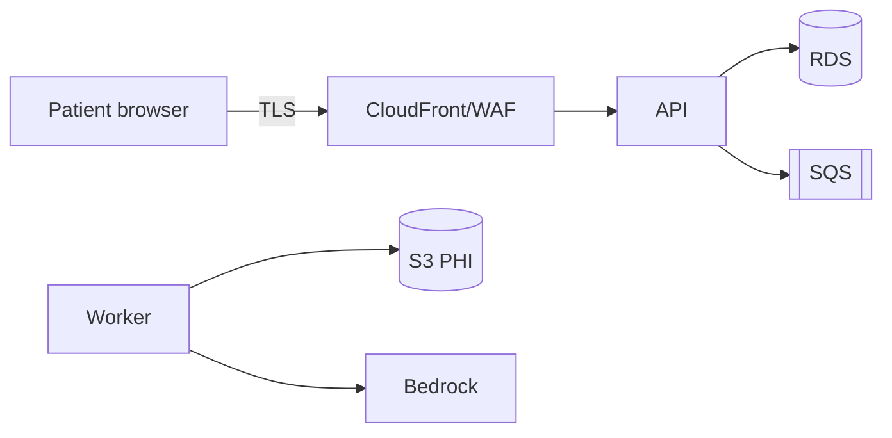

# Threat Model — <feature / system> (v<n>, <date>)

## Scope
## Data flow (actors, processes, stores, boundaries)

## Assets and data classes
## Threats
| ID | Element | STRIDE/LLM | Description | L | I | Score | Controls (SEC) | Residual | Owner |
| --- | --- | --- | --- | --- | --- | --- | --- | --- | --- |
## New requirements
## Decision
Proceed / proceed with conditions / blocked — rationale
