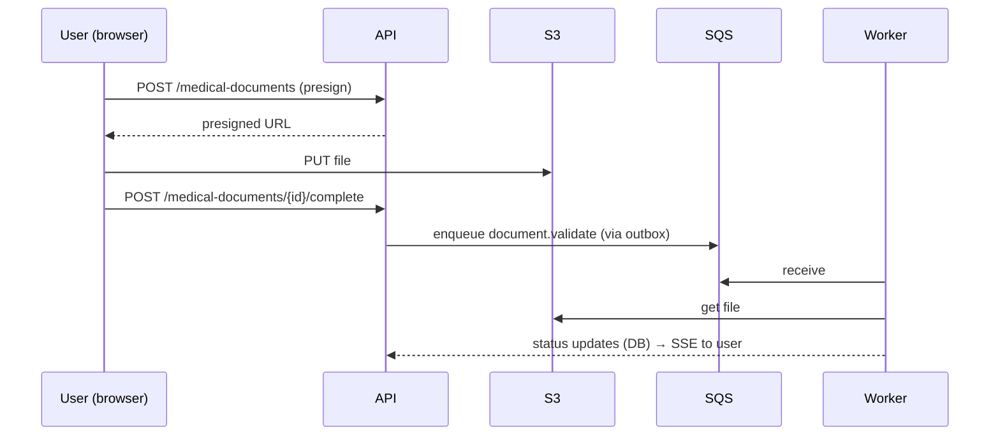

# Design Note — <feature>

## Problem and goals
## Constraints (NFR, SEC, BR)
## Components touched
## Sequence

## Data changes
## API changes (OpenAPI diff)
## Failure modes and handling
| Failure | Detection | Handling |
| --- | --- | --- |
## Security considerations (threat model delta)
## Observability (logs, metrics, traces, alarms)
## Rollout (flags, migration steps, backfill)
## Alternatives considered
