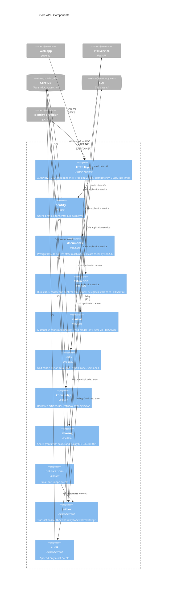

# C4 Level 3 - API Components (Core API modular monolith)

Status: Draft v0.1 - Owner: solution-architect (with backend-engineer) - Source: plan §8, §17, §24; ADR-0002.

Rule: modules talk only through `application` services and domain events (transactional outbox); import-linter enforces it in CI. Module names below are provisional; the authoritative list is the backend module map (TBD, owner: backend-engineer).

## Component notes
| Component | Rule |
| --- | --- |
| HTTP layer | Every endpoint has an authorization check and an authz test (`backend-engineer/assets/test-authz-template.py`). Foreign IDs return 404 and an audit event. |
| documents / extraction / clinical | No direct access to Clinical DB or `phi` bucket; go through PHI Service (SEC-AR-01). |
| units | `region_code` is the contract between data, API, GLB/SVG and viewer. New Unit = config + assets + schema + content (NFR-12). |
| outbox | Consumers are idempotent on `event_id`; retry with backoff, then DLQ (plan §16.4). |
| Worker | Same codebase, separate ECS service; consumes queue and does not accept user requests. |

## Open items
| Item | Owner |
| --- | --- |
| Final module list and import-linter contracts | backend-engineer |
| Policy & Consent as module vs separate service | solution-architect |
| Where the share-read path enforces Cedar policy | security-engineer |
