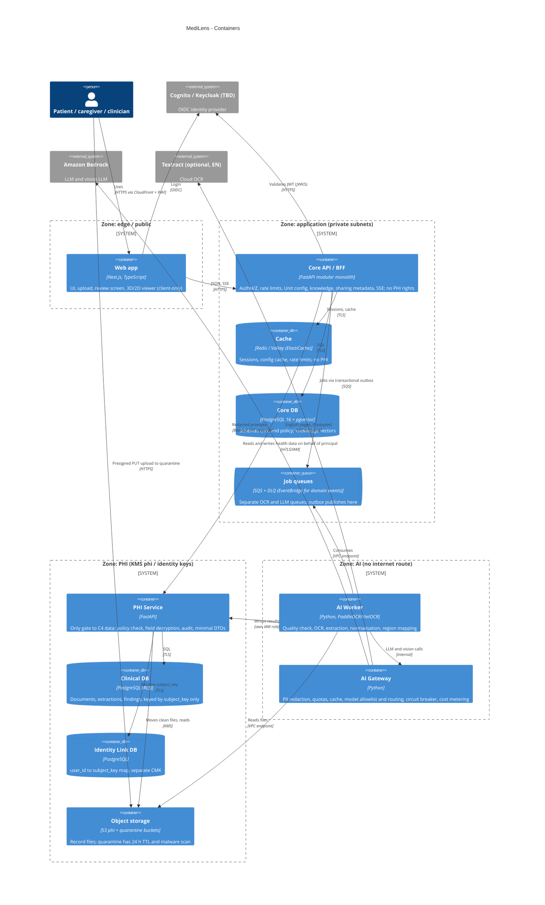

# C4 Level 2 - Containers

Status: Draft v0.1 - Owner: solution-architect - Source: plan §8, §16, §19, §24; ADR-0002 (modular monolith + worker), ADR-0004.

## Container responsibilities and trust
| Container | Responsibility | Data class | Trust zone | Key control |
| --- | --- | --- | --- | --- |
| Web app | UI, viewer, i18n VI/EN | C2 in browser; C4 only rendered | Public | CSP, HttpOnly cookies, no PHI in URLs/logs |
| Core API / BFF | Non-PHI logic, orchestration, SSE | C1-C2 | App | Authz on every endpoint + test; no DB/IAM rights to PHI (SEC-AR-01) |
| PHI Service | Sole reader/writer of C4 | C4 | PHI | Policy per request, field encryption, audit |
| AI Worker | OCR and extraction pipeline | C4 in memory | AI | Subnet without NAT/IGW (SEC-AR-03); VPC endpoints only |
| AI Gateway | Every LLM/OCR-cloud call | C4 to C2 after redaction | AI | IAM denies `bedrock:InvokeModel*` elsewhere (SEC-AR-04) |
| Core DB | Non-PHI data, pgvector | C1-C2 | App | RLS, KMS app key |
| Clinical DB | Health data by `subject_key` | C4 | PHI | No email/name/phone (SEC-AR-02); KMS phi; per-record DEK |
| Identity Link DB | `user_id` to `subject_key` | C3 | PHI | Separate CMK; PHI Service only |
| Redis/Valkey | Sessions, cache, throttles | C2 | App | No PHI |
| SQS + DLQ | Async jobs; at-least-once; idempotency key `event_id` | C2 (ids only) | App | Encrypted with KMS app key |
| S3 | Files; quarantine then phi | C4 | PHI | Presigned PUT 5 min, malware scan, versioned |
| Identity provider | Login, tokens | C3 | External/managed | TBD Cognito vs Keycloak |
| LLM/OCR providers | Extraction, vision | Redacted only | External | Gateway only; in-region |

## Notes
- Per ADR-0002 API and worker are separate ECS services from one codebase; PHI Service and AI Gateway are separate deployables because trust boundaries differ, not scale.
- Maturity level A (synthetic-only MVP) may host PHI Service as a module with own schema/role and the Gateway as a library; level B (before G3-P) splits them as drawn (plan §24.5).
- Policy & Consent, Audit and De-ID services (plan §24.1) are not drawn separately yet. TBD whether they are modules in Core API or deployables (owner: solution-architect, with security-engineer).
- Valkey vs Redis: plan names ElastiCache (Valkey); both speak the Redis protocol. The plan text also says the worker pulls jobs from Redis (§8) while §16.3 recommends SQS; this SAD follows SQS (TBD confirm in ADR-005, owner: solution-architect).
