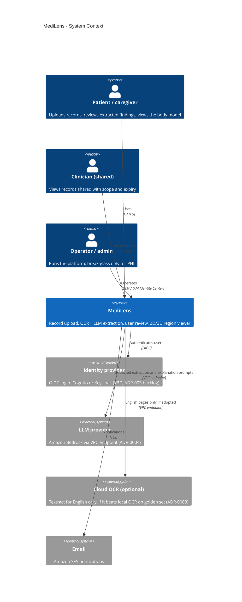

# C4 Level 1 - System Context

Status: Draft v0.1 - Owner: solution-architect - Source: plan §8, §16, §24; ADR-0002, ADR-0004.

MediLens helps patients understand their records. It illustrates and explains; it never diagnoses, doses or gives prognosis (BR-042).

## Trust boundaries at this level
| Boundary | Crossing | Control |
| --- | --- | --- |
| Internet to MediLens | Users, browsers | CloudFront + WAF, TLS, OIDC |
| MediLens to LLM/OCR | Text or images leaving our compute | Only via AI Gateway; PII redaction; in-region VPC endpoint; vendor assessment (SEC-AR-04) |
| MediLens to email | Notification content | No PHI in email bodies (TBD: template review, owner: security-engineer) |

## Open items
| Item | Owner |
| --- | --- |
| Identity provider choice (Cognito vs Keycloak) | solution-architect |
| Textract English adoption | ai-ml-engineer |
| Email content policy | security-engineer |
