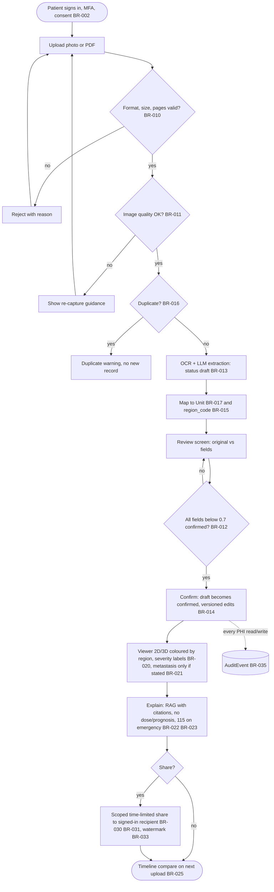

# Business Requirements Document — MediLens v1.0 (MVP)

| Version | Date | Author | Status |
| --- | --- | --- | --- |
| 1.0 | 2026-10-23 | BA | In review |

Sources: `docs/plan/project-plan.en.md` §1–4, §8, §11, §22, §26; `docs/agents/project-context.md`. Companion files: `business-rules.md` (BR catalog), `glossary-vi-en.md`. Synthetic data only.

## 1. Executive summary
Patients receive records full of jargon and cannot picture where a lesion is, how severe it is or how it changed. MediLens lets a patient upload a record (photo/PDF), extracts diagnoses, locations and measurements with OCR + LLM, asks the patient to confirm them, and shows them on a 3D/2D body model coloured by region with sourced plain-language explanations. It illustrates and explains; it never diagnoses, doses or gives prognosis (BR-042, BR-023). The MVP covers three Units: Dental, Cardiology (Internal Medicine) and Oncology. Success metric (North Star): confirmed records viewed on the viewer per week.

## 2. Business objectives
| ID | Objective | KPI | Target | Measured by |
| --- | --- | --- | --- | --- |
| BO-1 | Patients see lesions on the body model | Documents extracted and mapped to correct region | ≥ 85% on test set | AI golden-set eval (plan §10.1) |
| BO-2 | Explanations with sources, never replacing a doctor | AI answers with citations + disclaimer | 100% | RAG eval, snapshot tests |
| BO-3 | Track progression | Timeline with ≥ 2 points for one finding | Achieved in beta | Product analytics |
| BO-4 | Users complete the core flow | Activation (upload + confirm ≤ 7 days) | ≥ 40% | Product analytics (plan §10.2) |
| BO-5 | Fast time to value | Upload → first viewer visit | ≤ 5 min | Product analytics |
| BO-6 | Users trust and review results | Review completion | ≥ 70% | Product analytics |

## 3. Stakeholders (RACI)
| Stakeholder | Interest | R/A/C/I |
| --- | --- | --- |
| Patient | Understand own record, track progress | C (primary user, interviews/UAT) |
| Caregiver | View a relative's record when permitted | C |
| Clinician | Quick summary, correct wrong extraction (receives shares) | C |
| Admin | Users, anatomy content, audit | C |
| Medical reviewer | Approves condition templates, region mappings, KnowledgeArticles | R for content, A via Clinical Safety Officer |
| Product Owner | Scope, priorities, go/no-go | A |
| Business Analyst | Requirements, rules, traceability | R |
| Clinical Safety Officer / Regulatory Officer | Safety case, SaMD boundary, consent texts | C, gate approvers (G0-R, G2-CS) |
| Engineering roles (BE, FE, AI/ML, DE, Sec, QA) | Build and verify | R (delivery) |

## 4. Scope
- **In scope (MVP v1.0):** email/Google sign-in with MFA; profiles; photo/PDF upload with Vietnamese + English OCR; extraction of diagnosis, location, severity, date; review/confirm screen; 2D + 3D viewer for Dental, Cardiology, Oncology; LLM explanations with RAG and citations; pre/post timeline and time-limited sharing (Should); admin and audit.
- **Out of scope:** diagnosis, prescribing, automatic lesion detection or measurement on images (BR-042), HIS/EMR write-back or hospital integration, payments, native mobile, CT/DICOM, text-description and digital-record inputs (BR-040…045, v2), further Units (Surgery, Nephrology–Urology, Gastroenterology, Respiratory in v1.5; Dermatology, Ophthalmology, ENT in v2.0), reminders, FHIR export/import.

## 5. Current state (As-Is) and pain points
Records are paper or loose photos/PDFs, multi-page, in jargon and abbreviations (see glossary). Patients cannot localise or grade findings, lose paper records, and doctors have little time to explain. Caregivers have no access to a relative's information. There is no structured, comparable history across visits.

## 6. Future state (To-Be)

Key to-be behaviours: files go direct to object storage; extraction runs asynchronously in the worker; only `confirmed` data reaches the viewer; unmappable locations are listed, never guessed; every screen with medical meaning carries the "illustration, not a substitute for your doctor" disclaimer.

## 7. High-level business requirements
| ID | Requirement | Priority (MoSCoW) | Source |
| --- | --- | --- | --- |
| HLR-1 | Register, sign in with MFA support, accept consent before first upload | Must | §2.4, BR-001…006 |
| HLR-2 | Upload photo/PDF with quality and duplicate checks | Must | BR-010, 011, 016 |
| HLR-3 | Extract diagnosis, location, severity, date with confidence scores | Must | §2.4, BR-012 |
| HLR-4 | Review/correct screen; only confirmed data is displayed | Must | BR-012, 013, 014 |
| HLR-5 | 2D + 3D viewer for Dental, Cardiology, Oncology, coloured by region and severity | Must | §3.1, BR-015, 017, 020, 021 |
| HLR-6 | Sourced plain-language explanations with guardrails | Must | BR-022, 023, 024 |
| HLR-7 | Pre/post timeline for same Region + Condition | Should | BR-025 |
| HLR-8 | Time-limited, revocable sharing with doctor/relative | Should | BR-030, 031, 033 |
| HLR-9 | Export and delete own data; audit all PHI access; no training without opt-in | Must | BR-032, 034, 035 |
| HLR-10 | New Units addable by configuration + assets only | Must | §3 |
| HLR-11 | Computer vision on lesion photos, extra Units, reminders | Could (post-MVP) | §2.4 |

## 8. Business rules (reference BR-xxx)
The full catalog (id, rule, owner, source, test idea) is in `business-rules.md`: BR-001…006 access, BR-010…017 documents/AI, BR-020…025 display/content, BR-030…035 sharing/data rights, BR-040…045 multi-source/imaging (v2). Safety-critical rules for the MVP: BR-012, BR-013, BR-021, BR-022, BR-023, BR-042. Gaps (TBD ids) are listed at the end of that file.

## 9. Constraints (legal, technical, budget, time)
- **Legal:** Law on Personal Data Protection 91/2025/QH15 and Decree 356/2025/ND-CP (health data is sensitive: explicit consent, DPIA, overseas-transfer assessment, breach notice within 72 h); medical-device (SaMD) boundary under Decree 98/2021 as amended: intended use limited to illustration and education, no diagnosis claims (plan §22.2); gate G0-R at end of discovery.
- **Technical:** modular-monolith API + async AI worker; Vietnamese and English OCR; `region_code` is the contract between data, API, assets and viewer.
- **Data:** synthetic or public data in development; no real patient data in repo, dev/staging, logs or tests.
- **Budget/time:** one-person project, about 20 h/week, 9–12 months part-time; MVP limited to 3 Units; LLM cost controlled by caching and small models.

## 10. Assumptions and dependencies
- Users hold copies of their records as photos/PDFs; hospitals offer no patient API (plan §22.2).
- Open-licence 3D/2D anatomy assets are available and recorded in `ATTRIBUTION.md`.
- Clinicians (external) are available to review KnowledgeArticles and region mappings (Medical Reviewer role).
- Dependencies: gate G0-R (intended use, RDR), G1-D before any training, G2-CS before beta, G3-P before real data.

## 11. Risks
| ID | Risk | L | I | Mitigation |
| --- | --- | --- | --- | --- |
| R01 | Users mistake illustrations for diagnosis | 3 | 5 | Disclaimers, "your record states" wording, guardrails (BR-023) |
| R02 | Health-data leak | 3 | 5 | Threat model, authz tests, RLS, encryption, synthetic data (BR-006, 035) |
| R03 | Solo overload, abandonment | 4 | 4 | 3-Unit MVP, timeboxes, cut scope |
| R04 | LLM hallucination | 4 | 4 | Structured output, human review, RAG only (BR-012, 022) |
| R05 | Poor OCR on handwriting and bad photos | 5 | 3 | Quality check, capture guidance (BR-011) |
| R07 | Breach of PDPL / cross-border transfer | 3 | 5 | Consent, DPIA, PII redaction (BR-002) |
| R11 | Wrong region or side | 3 | 4 | Laterality rules, `unmapped` (BR-015) |
| R16 | Metastasis visuals cause distress | 3 | 4 | Reassuring language, separate reference layer (BR-021) |

Full register: plan §11.

## 12. Success criteria and acceptance
- Goals G1–G3 of the plan §1 met on the golden set and in beta (BO-1…BO-3).
- Product thresholds in BO-4…BO-6 met in beta; comprehension score ≥ 80%, task success ≥ 80% (plan §10.2).
- Every MVP BR has at least one user story and one passing test in the traceability matrix (`check_traceability.py` shows no MUST gap).
- No unacceptable risk left in hazard log; Clinical Safety Case signed (G2-CS).
- Acceptance of this BRD: Product Owner approves after review by Product Manager and QA.

## 13. Approval
| Role | Name | Decision | Date |
| --- | --- | --- | --- |
| Product Owner | | Pending | |
| Product Manager (reviewer) | | Pending | |
| QA Engineer (reviewer) | | Pending | |
