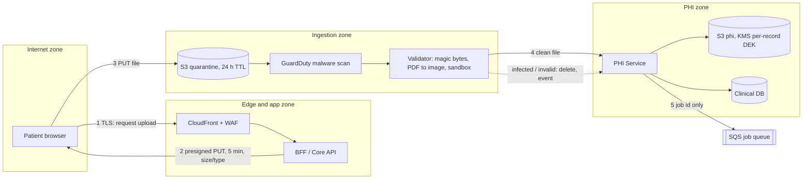
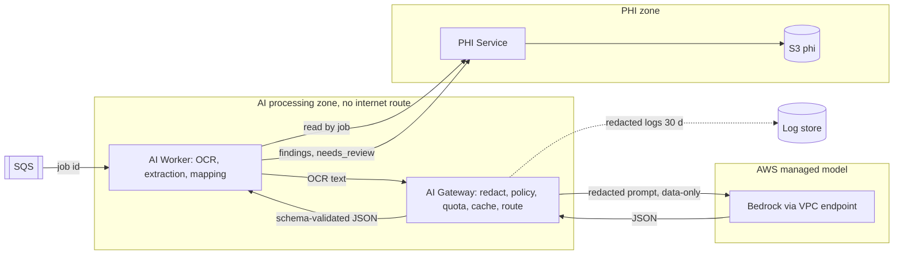
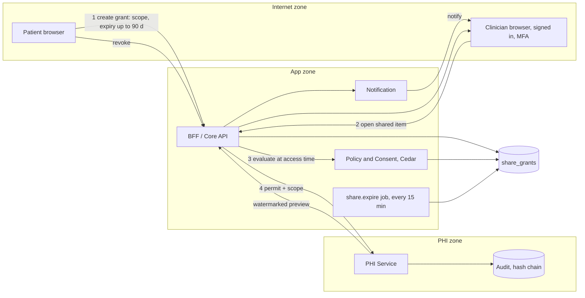

# Threat Model v1: upload, AI pipeline, sharing (2026-10-23)

Task S3-T29. Owner: security-engineer. Reviewers: solution-architect, regulatory-privacy-officer.
Method: STRIDE per element (plus OWASP Top 10 for LLM for the AI flow). Score = L x I (1-5 each; 15+ High, 8-14 Medium, below 8 Low).
Sources: plan section 13 (SEC requirements), section 24 (PHI boundary), `references/threat-model-stride.md` seed T01-T14, ADR-004 (region, Bedrock).
Abuse cases: see `abuse-cases.md`. Review this model when a flow, store, provider or role is added.

## 1. Scope and assumptions
- In scope: F-UP document upload (presigned URL, quarantine, scan, processing handoff), F-AI AI pipeline (OCR, LLM extraction via AI Gateway, redaction, injection), F-SH sharing (time-limited ShareGrant, BR-030, BR-031, BR-033).
- Out of scope in v1: DICOM/CT intake (SEC-AR-08, v2), analytics export (seed T09), CI/CD supply chain (seed T11), authentication (seed T06). Tracked as open items.
- Assumes maturity level B target design (plan 24.5). At level A (synthetic data only) PHI Service and AI Gateway are in-process modules, so the PHI and AI-gateway boundaries are logical, not network, boundaries. This lowers assurance and is accepted only while data is synthetic.
- Data classes: C4 original files, OCR text, findings; C3 identity (Identity Link); C2 metadata, share grants, audit.

## 2. Assets
| Asset | Class | Why it matters |
| --- | --- | --- |
| Original document files and OCR text | C4 | Highest sensitivity health data |
| Extracted findings / region_code mapping | C4 | Shown to user; wrong content can mislead (BR-042) |
| ShareGrant (scope, expiry, revoked_at) | C2 | Controls clinician access to C4 |
| Per-record DEK, `kms/phi` | key | Crypto-shredding, confidentiality |
| Audit log | C2 | Non-repudiation, breach evidence |
| LLM quota / budget | cost | Denial of wallet |

## 3. DFD 1: document upload

Trust boundaries: TB1 internet/edge, TB2 edge/app, TB3 app/ingestion (quarantine readable only by scanner and validator), TB4 ingestion/PHI zone (only PHI Service writes `phi`, SEC-AR-01).

### 3.1 Threats: upload
| ID | Element | STRIDE | Threat | L | I | Score | Controls | Residual | Owner |
| --- | --- | --- | --- | --- | --- | --- | --- | --- | --- |
| U-01 | Browser to BFF (presign request) | S | Attacker requests presign for another profile | 3 | 5 | 15 | SEC-AZ-01/02, SEC-AZ-03 RLS, authz matrix test | Low | backend-engineer |
| U-02 | Presigned PUT | T | Upload type or size beyond declared (polyglot, 5 GB file) | 4 | 3 | 12 | SEC-DP-05 content-type/size conditions, SEC-AP-07, SEC-AP-08 | Low | backend-engineer |
| U-03 | Presigned PUT | R | User denies uploading a file; no record of who | 2 | 3 | 6 | SEC-LG-01 audit with DocumentUploaded, SEC-LG-02 | Low | backend-engineer |
| U-04 | Presigned URL leak (logs, referrer, shared screen) | I | URL reused to overwrite or probe quarantine | 3 | 3 | 9 | SEC-DP-05 TTL 5 min, object key bound to upload id, SEC-DP-06 no URLs in logs, PUT-only | Low | security-engineer |
| U-05 | Quarantine bucket | T, E | Malicious file (polyglot PDF, zip bomb, macro) reaches parser | 3 | 4 | 12 | SEC-AP-07, SEC-AR-09, sandboxed parser, PDF to image, EICAR + malicious PDF tests | Medium: scanners miss zero-day | ai-ml-engineer |
| U-06 | Scan to promote step | T | TOCTOU: object replaced after scan, before promotion | 2 | 4 | 8 | Promote by version id + checksum; quarantine denies overwrite after scan (new requirement O-01) | Low | cloud-devops-engineer |
| U-07 | Quarantine / S3 `phi` | I | Public bucket, over-broad IAM, unencrypted copy | 2 | 5 | 10 | SEC-DP-02/04, SEC-AR-01, SEC-IN-03, Config + Access Analyzer | Low | cloud-devops-engineer |
| U-08 | Quarantine leftovers | I | Rejected files linger beyond 24 h | 3 | 3 | 9 | Lifecycle rule 24 h, delete on reject, alarm on age | Low | cloud-devops-engineer |
| U-09 | Upload endpoint | D | Flood of presigns / large uploads fills storage or scan queue | 3 | 3 | 9 | SEC-AP-08 rate and quota per user, SEC-IN-06 WAF rate rule, per-user pending cap | Low | backend-engineer |
| U-10 | Scan to SQS | E | Job message tampered to point at another object | 2 | 5 | 10 | Job carries ids only; worker re-checks ownership via PHI Service (SEC-AZ-02); SQS KMS SEC-DP-02 | Low | backend-engineer |
| U-11 | Document metadata / filename | I, T | Filename or EXIF holds PHI or injection; stored in logs | 3 | 3 | 9 | Generate server-side keys, strip EXIF, SEC-DP-06, SEC-AP-01 | Low | backend-engineer |

## 4. DFD 2: AI pipeline

Trust boundaries: TB4/TB5 (worker gets only documents assigned by job), TB5/TB6 (only through AI Gateway; IAM denies direct Bedrock, SEC-AR-04), plus the untrusted-content boundary: all document text is attacker-controlled data, even inside TB5.

### 4.1 Threats: AI pipeline
| ID | Element | STRIDE / LLM | Threat | L | I | Score | Controls | Residual | Owner |
| --- | --- | --- | --- | --- | --- | --- | --- | --- | --- |
| A-01 | Document text to LLM | T, E / LLM01 | Indirect prompt injection (visible or hidden text) changes extraction or findings | 4 | 4 | 16 | SEC-AI-01, SEC-AI-03, LLM has no tools, rasterise PDF, delimit text as data, user review step, LLM-01/02 tests | Medium: injection never fully eliminated; human review is the backstop | ai-ml-engineer |
| A-02 | AI Gateway redaction | I | PII (name, phone, ID number) reaches provider | 3 | 5 | 15 | SEC-AI-02 recall >= 99%, SEC-AR-04, fail closed if redaction errors (O-03), LLM-11 test | Medium: 1% miss tolerated by target, DPIA to accept | mlops-engineer |
| A-03 | Bedrock provider | I | Provider retains or trains on PHI; data leaves region | 2 | 5 | 10 | SEC-AI-06 vendor terms, ADR-004 region, VPC endpoint (SEC-IN-05), overseas-transfer assessment | Medium until vendor assessment signed | security-engineer |
| A-04 | LLM output | T / LLM05 | Output with extra fields, HTML, or markdown image to external URL | 3 | 3 | 9 | SEC-AI-03 schema validation, repair then needs_review, SEC-AP-03/04 CSP, LLM-08/10 | Low | ai-ml-engineer |
| A-05 | Retrieval / explain | I | Another user's findings returned (cross-user retrieval) | 2 | 5 | 10 | SEC-AI-04 scoping in code, SEC-AZ-03 RLS, LLM-04/05 | Low | backend-engineer |
| A-06 | Worker identity | E | Worker reads documents not assigned, or calls Bedrock directly | 2 | 5 | 10 | SEC-AR-01/03/04, per-job scoped access, IAM policy tests | Low at level B; Medium at level A (shared process) | cloud-devops-engineer |
| A-07 | Gateway quota | D / LLM10 | Denial of wallet via many uploads/questions or huge pages | 3 | 3 | 9 | SEC-AI-07, SEC-AP-08, page/token caps, circuit breaker, LLM-09 | Low | mlops-engineer |
| A-08 | Prompts and logs | I, R | Prompt log holds PHI; prompt changed without review | 3 | 4 | 12 | SEC-AI-08 redacted logs 30 d, SEC-DP-06, SEC-AI-09 prompts versioned via PR + eval | Low | mlops-engineer |
| A-09 | Gateway cache | I | Cache hit returns another user's result (key collision) | 2 | 4 | 8 | Cache key includes profile scope and prompt version (O-02), KMS (kms/app), hash-keyed | Low | mlops-engineer |
| A-10 | Extraction result | T | Wrong or injected content shown as fact; model output reads like advice | 3 | 5 | 15 | User review before confirmation, SEC-AI-05 guardrails, BR-042 wording, clinical-safety-officer hazard link | Medium (clinical hazard owned by CSO) | clinical-safety-officer |
| A-11 | Prompt leakage | I / LLM07 | System prompt extracted | 3 | 2 | 6 | No secrets in prompts, LLM-12 | Low | ai-ml-engineer |

## 5. DFD 3: sharing

Trust boundaries: TB1/TB2 (every request authenticated, no anonymous links per BR-031), TB2/TB4 (PHI Service re-checks policy per request).

### 5.1 Threats: sharing
| ID | Element | STRIDE | Threat | L | I | Score | Controls | Residual | Owner |
| --- | --- | --- | --- | --- | --- | --- | --- | --- | --- |
| S-01 | Grant creation | S | Attacker with stolen session shares victim's records to own account | 3 | 5 | 15 | SEC-ID-03 MFA to share, SEC-ID-08 alerts, notify owner on ShareGranted, SEC-ID-04/05 | Medium: session theft depends on identity controls (seed T06) | security-engineer |
| S-02 | Grantee link | S, E | Link replayed by non-grantee or after expiry/revoke (seed T05) | 3 | 4 | 12 | BR-031 signed-in recipients only, SEC-AZ-04 check at access time, cache <= 60 s, SEC-AR-07 policy tests | Low | backend-engineer |
| S-03 | Scope check | E | Scope widening: per-document grant opens other documents (IDOR) | 3 | 5 | 15 | SEC-AZ-02 per-ID check, SEC-AZ-03 RLS, SEC-AZ-07 DTO allowlist, authz matrix test | Low | backend-engineer |
| S-04 | Expiry | E | Grant outlives expiry (job lag, clock skew, cache) | 3 | 4 | 12 | Evaluate expires_at at access time, not only by job; SEC-LG-02 UTC; max 90 d enforced server side (BR-030) | Low | backend-engineer |
| S-05 | Revoke | E | Revoke not instant: cached decisions, open sessions, copies | 4 | 3 | 12 | Cache <= 60 s (SEC-AZ-04), no download of originals for grantees, SEC-DP-09 watermark | Medium: viewed data can be photographed or copied | backend-engineer |
| S-06 | Grantee identity | S | Fake "clinician" account receives shares | 3 | 4 | 12 | SEC-ID-09 clinician verification (O-04), SEC-ID-03 MFA, explicit grantee confirmation | Medium until verification workflow exists | product-manager |
| S-07 | Share access | R | Dispute over who viewed what (seed T14) | 2 | 3 | 6 | SEC-LG-01 / SEC-AR-05 audit of every access, visible to owner | Low | backend-engineer |
| S-08 | Shared preview | I | Preview leaks beyond recipient (screenshot, forward) | 3 | 3 | 9 | SEC-DP-09 watermark with recipient name (BR-033), short expiry default 7 d | Medium: cannot be fully prevented | frontend-engineer |
| S-09 | Bulk access | I | Compromised clinician account scrapes many patients | 2 | 5 | 10 | SEC-LG-03 bulk-download alert, SEC-AP-08 rate limit, MFA | Low | sre-operations |
| S-10 | Admin | E, R | Admin reads shared PHI silently (seed T07) | 2 | 5 | 10 | SEC-AZ-05 break-glass, SEC-LG-01 | Low | security-engineer |
| S-11 | Notifications | I | Email leaks PHI or reveals a share to a wrong address | 2 | 3 | 6 | Emails carry no PHI, only a sign-in link; SEC-DP-06 | Low | backend-engineer |

## 6. New requirements and open items
| ID | Item | Type | Owner | Target | Status | Evidence |
| --- | --- | --- | --- | --- | --- | --- |
| O-01 | Add promote-by-version-id + checksum rule to SEC-AP-07 (U-06) | New requirement | security-engineer | Sprint 4 | Open: defined as SEC-AP-07a, not implemented | `docs/security/security-requirements.md` |
| O-02 | Cache key includes profile scope + prompt version, in AI Gateway spec (A-09) | New requirement | mlops-engineer | Sprint 4 | Done: SEC-AI-10 verified by unit tests | `apps/ai-gateway/tests/test_gateway.py` |
| O-03 | Add "fail closed when redaction errors" to SEC-AI-02 (A-02) | New requirement | ai-ml-engineer | Sprint 4 | Done: SEC-AI-02a verified by unit test | `apps/ai-gateway/tests/test_gateway.py` |
| O-04 | Define clinician verification workflow (S-06); promote SEC-ID-09 to MUST before clinician shares | Decision | product-manager | before G3-P | Open | - |
| O-05 | Vendor assessment for Bedrock and overseas-transfer assessment signed (A-03) | Compliance | regulatory-privacy-officer | before real data | Open | - |
| O-06 | Measure redaction recall on the labelled set; record in sign-off (A-02) | Test | ai-ml-engineer | before G3-P | Open | - |
| O-07 | Run LLM-01..12 suite; record results in release sign-off | Test | qa-engineer | each release | Open | - |
| O-08 | Level A to B boundary hardening (A-06); until then synthetic data only | Constraint | solution-architect | G3-P | Open | - |
| O-09 | Extend model to DICOM intake, analytics export, CI supply chain, auth | Scope | security-engineer | model v2 | Open | - |

## 7. Residual risk summary
No threat is rated High after controls. Medium residuals: U-05 (scanner evasion), A-01 (injection), A-02 (redaction miss), A-03 (vendor, pending), A-06 (level A only), A-10 (clinical misleading output), S-01 (session theft), S-05 and S-08 (viewed data cannot be unseen), S-06 (clinician verification). Residuals A-02, A-03, A-10 need explicit acceptance in the DPIA and the Clinical Safety Case.

## 8. Decision
Proceed with conditions: real patient data is blocked until O-01..O-06 and O-08 are closed and tests for the listed SEC codes pass. Synthetic-data development may continue. All controls are Planned unless a test exists; this document does not claim they are implemented.
