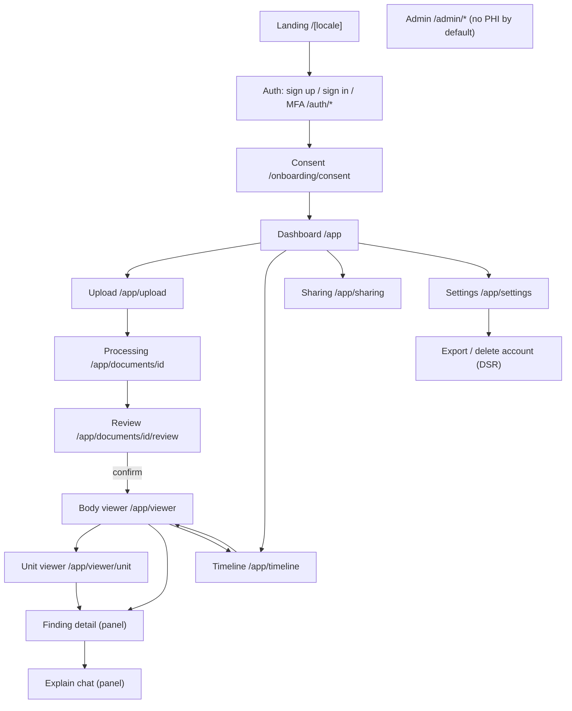
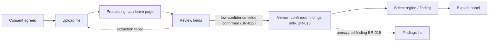

# MediLens IA and Sitemap (MVP) [S2-T10]

Status: draft v0.1 for review. Owner: medilens-ux-ui-designer. Reviewers: business-analyst, frontend-engineer, clinical-safety-officer (Viewer/Explain wording).
Sources: plan 2.3, 2.4, 3, 4.3; skill references `screen-inventory.md`, `unit-viewer-patterns.md`. MediLens illustrates and explains; it never diagnoses, doses or gives prognosis (BR-042).

## 1. Sitemap

The 8 screens specified in `wireframes/`: Consent, Upload, Review, Viewer, Explain, Timeline, Share, Settings. Dashboard, Processing, Unit viewer and Admin are out of scope of this task (listed for navigation completeness).

## 2. Core flow: upload to explain

| Step | Screen | Gate / rule |
| --- | --- | --- |
| 1 | Consent | BR-002: consent before first upload; no pre-ticked boxes |
| 2 | Upload | BR-010/011: JPG/PNG/HEIC/PDF, max 20 MB, max 30 pages, blur rejected |
| 3 | Review | BR-012: confidence under 0.7 must be confirmed by user |
| 4 | Viewer | BR-013: only confirmed data; BR-015: unmapped stays in list; BR-020 severity colour plus text |
| 5 | Explain | BR-022/023: approved sources only, no dose/prognosis; BR-041 emergency shows 115 first |

## 3. Navigation model
- Primary nav (desktop top bar / mobile bottom bar): Home (Dashboard), Upload, Body viewer, Timeline, Sharing; Settings under the profile menu.
- Persistent `DisclaimerBar` on Viewer, Unit viewer, Finding detail and Explain.
- Language switch VI/EN in header and Settings; VI default.
- Deep links keep `region_code` in the URL query so Viewer, list and Explain agree (region_code is the contract).
- Server-side authorization on every route; unauthenticated access redirects to sign-in, missing consent redirects to Consent.

## 4. Screen index

| Screen | Route | Primary action | Wireframe |
| --- | --- | --- | --- |
| Consent | /onboarding/consent | Agree | [consent](wireframes/consent.md) |
| Upload | /app/upload | Choose or take photo | [upload](wireframes/upload.md) |
| Review | /app/documents/[id]/review | Confirm | [review](wireframes/review.md) |
| Viewer | /app/viewer | Select region | [viewer](wireframes/viewer.md) |
| Explain | panel on Viewer | Send question | [explain](wireframes/explain.md) |
| Timeline | /app/timeline | Compare dates | [timeline](wireframes/timeline.md) |
| Share | /app/sharing | Create share | [share](wireframes/share.md) |
| Settings | /app/settings | (none; DSR actions) | [settings](wireframes/settings.md) |

## 5. Shared patterns
SeverityChip (colour + icon + text label, BR-020) · SourceBadge · DisclaimerBar · ConfidenceField · RegionListItem · ProcessingStepper · ShareScopePicker · EmptyState · ErrorState · BottomSheet.

## 6. Responsive and wireframe conventions
- Mobile 360 px is the baseline; desktop 1280 px. Viewer: under 768 px 2D default and detail as bottom sheet; 1024 px and up side panel.
- Wireframes are low-fidelity ASCII: `[ ]` button, `[x]` checkbox, `{ }` input, `<chip>` chip. No final colours or typography; tokens come from `design-tokens.json`.
- All sample content is synthetic.

## 7. Open questions
- Exact severity label wording per colour: confirm with clinical-safety-officer.
- Dashboard and Processing wireframes: follow-up task.
